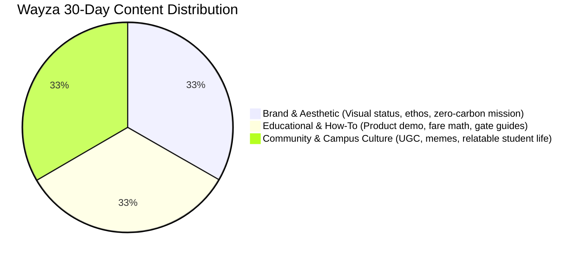

# 🚗 Wayza — Instagram Brand Curation & Growth Strategy
**Handle Concept:** `@wayza.in` / `@ridewayza`  
**Tagline:** *Your Campus Ride, Shared Smartly.*

---

## 1. Profile Architecture & Bio Optimization

Your profile header is your digital storefront. For a campus tech platform targeting Gen Z university students, it needs to convey instant credibility, cost savings, and exclusivity in under 3 seconds.

### Profile Layout
* **Profile Picture:** Clean Wayza wordmark/monogram in Electric Indigo (`#6366f1`) on deep obsidian dark background (`#0a0a0a`) with subtle frosted-glass rim lighting.
* **Name Field:** `Wayza | Campus Rides @ MIT-WPU 🚗` *(Optimized for Instagram search discovery)*
* **Username:** `@wayza.in`
* **Bio Copy:**
  ```text
  💸 Solo cabs: ₹350. Sharing on Wayza: ₹87.
  🔒 100% verified students only (@mitwpu.edu.in)
  ⚡ Instant peer matching + auto rupee fare split
  📍 Front Gate • Back Gate • Sports Complex
  👇 Hop in for tomorrow's commute:
  ```
* **Link in Bio:** `wayza.in/app` *(Or smart Linktree/Bento with: 1. Web App Signup, 2. Live Commute Radar, 3. WhatsApp Campus Ambassador Portal)*

### Story Highlights (Cohesive Frosted Glass + Minimalist Icons)
1. 🚀 **`HOW IT WORKS`** — 4-slide animated walkthrough: Domain signup ➔ Proximity search ➔ Live Chat ➔ Exact Rupee Split.
2. 💰 **`SPLIT MATH`** — Real screenshots of savings: Pune Station to Kothrud, Baner to MIT-WPU, Viman Nagar carpools.
3. 🛡️ **`SAFETY`** — Explaining `@mitwpu.edu.in` domain verification, phone OTP, and incident reporting.
4. 📍 **`CAMPUS GATES`** — Meetup points: MIT-WPU Front Gate, Back Gate, Paud Road pickup etiquette.
5. 💬 **`RIDE CREWS`** — Curated UGC re-shares of students riding together, memes, and community testimonials.

---

## 2. Visual Identity & Aesthetic Framework

Wayza’s aesthetic bridges **cinematic editorial elegance** with **high-velocity Gen Z mobility**. It avoids cheap corporate looks in favor of a sleek, dark-mode, lifestyle magazine feel.

### Color Palette

| Token | Hex / Value | Mood & Application |
| :--- | :--- | :--- |
| **Obsidian Dark** | `#0a0a0a` | Primary background, feed grounding, dark-mode sleekness |
| **Electric Indigo** | `#6366f1` | Brand accents, notification badges, active buttons, neon halos |
| **Mint Rupee** | `#10b981` | Split savings indicators, success states, green mobility |
| **Frosted Glass** | `rgba(255, 255, 255, 0.08)` | Card overlays, UI mockup frames, floating badges |
| **Paper White** | `#f8fafc` | Crisp typography, headline contrast |
| **Muted Slate** | `rgba(255, 255, 255, 0.6)` | Subtitles, timestamps, UI metadata |

### Typography Hierarchy
* **Headlines & Editorial Hooks:** `Instrument Serif` (Italicized emphasis, high-end editorial contrast: *"Why are you still paying ₹350 alone?"*)
* **Body Copy & UI Metrics:** `Inter` (500/600 weight, ultra-clean digital legibility)
* **Numbers & Savings Badges:** Monospace or tabular `Inter` (e.g., `₹87 / seat`)

### Photography & Art Direction
* **Vibe:** Cinematic 35mm film grain, golden hour sunlight hitting Pune streets, candid auto-rickshaw rides with friends laughing, glowing phone screens displaying the Wayza UI in frosted glass.
* **No Corporate Stock:** Zero generic suits or foreign cars. Authentic Indian campus context: Pune auto-rickshaws, bike-carpools, campus landmarks (MIT-WPU World Peace Dome, Paud Road, Sarasbaug, ARAI hills).

---

## 3. The 9-Post Cohesive Grid System

To create an editorial, scroll-stopping first impression when freshers and campus students land on your profile, the 9-grid follows a **dynamic alternating checkerboard**: Alternating between **Dark UI/Motion Mockups**, **Candid Campus Film Photography**, and **High-Contrast Text/Data Hooks**.

```
┌──────────────────────┬──────────────────────┬──────────────────────┐
│       POST 1         │       POST 2         │       POST 3         │
│  [Dark UI Reel]      │  [Campus Editorial]  │  [Data Carousel]     │
│  "Meet Wayza in 30s" │  "Front Gate at 5PM" │  "The ₹14,000 Pune   │
│  Sleek app animation │  Golden hour 35mm    │   Commute Tax"       │
├──────────────────────┼──────────────────────┼──────────────────────┤
│       POST 4         │       POST 5         │       POST 6         │
│  [Relatable Meme]    │  [Feature Deep-Dive] │  [Student Story]     │
│  "POV: Waiting for   │  "Never ask for GPay │  "How 4 Mech seniors │
│   auto at Paud Rd"   │   again" (Fare-split)│   saved ₹6k/month"   │
├──────────────────────┼──────────────────────┼──────────────────────┤
│       POST 7         │       POST 8         │       POST 9         │
│  [Green/Impact Stat] │  [Motion Reel]       │  [Manifesto Post]    │
│  "1 Campus. 500 fewer│  "From Match to Auto │  "Why we built this  │
│   cabs a day."       │   in 60 seconds"     │   for MIT-WPU"       │
└──────────────────────┴──────────────────────┴──────────────────────┘
```

---

## 4. Multi-Format Content Framework (The 1/3 Rule)

Your monthly 30-day posting cadence distributes 12–15 high-value feed posts, 8–10 Reels, and daily interactive Stories.



### Pillar 1: Brand & Aesthetic (1/3)
* **Goal:** Position Wayza not just as a tool, but as a lifestyle upgrade that smart, modern college students use.
* **Content Formats:** Cinematic lifestyle Reels, sleek product UI teasers, environmental reduction metrics, founder design notes.
* **Sample Post:** *“The Commute Shouldn’t Drain Your Allowance.”* (3-slide carousel pairing moody rainy Pune street photography with crisp glassmorphism UI overlay).

### Pillar 2: Educational & Product Utility (1/3)
* **Goal:** Remove onboarding friction, address safety doubts, and explain the fare-split mechanics.
* **Content Formats:** Screen-recorded carousels, step-by-step guides, safety breakdown videos.
* **Sample Post:** *“How Wayza Splits ₹340 Between 4 People to the Exact Rupee”* (Infographic showing zero awkward GPay reminders).

### Pillar 3: Community & Campus Relatability (1/3)
* **Goal:** Viral distribution across campus WhatsApp group chats, meme culture, and student reposts.
* **Content Formats:** Relatable POV Reels, auto-driver interaction skits, student confessions, campus trivia.
* **Sample Post:** *“POV: It’s 9:10 AM, attendance closes at 9:15, and 3 auto drivers just rejected you at Paud Road.”*

---

## 5. High-Impact Reels Playbook (Scripts & Hooks)

Reels are the primary engine for organic reach on Instagram in Pune. Below are 3 production-ready concepts designed specifically for MIT-WPU commuters:

### Reel Concept 1: The "Curb Math" (High Conversion)
* **Hook (0-3s):** Split screen text over fast-paced Pune auto footage:  
  *Top:* "What MIT-WPU freshers spend on cabs" vs *Bottom:* "What Wayza users spend."
* **Visuals (3-15s):** 
  - Student A pays ₹320 alone for an Ola from Baner, looks stressed.
  - Student B taps 3 buttons on Wayza, meets two classmates at Back Gate, hops in the same cab.
  - Screen displays Wayza's live Fare Split screen: `₹320 ÷ 4 = ₹80 per person`.
* **Audio:** Fast, punchy trending phonk beat or chill Lo-fi hip-hop.
* **Caption:** *Stop funding cab surges alone. Verified college email required. Link in bio to join today’s crew. 🚗⚡*
* **CTA:** "Tag your daily commute buddy who needs this."

### Reel Concept 2: The "Awkward GPay" Antidote
* **Hook (0-3s):** Close up of someone typing: *"Bro can you please send that ₹85 from Tuesday..."* then deleting it in shame.
* **Visuals (3-12s):** 
  - Cut to Wayza’s **Automated Fare Splitting** screen.
  - Leader enters total meter: ₹240.
  - Screen shows one-tap digital acknowledgements from all riders instantly.
* **Caption:** *Wayza eliminates the post-ride awkwardness. Equal shares, instant settlement, zero lost friendships.*
* **CTA:** *Try it on your next trip to campus. Link in bio.*

### Reel Concept 3: "Spotted at MIT Front Gate" (Campus Culture)
* **Hook (0-3s):** Candid phone camera tracking students exiting the World Peace Dome gate.
* **Visuals (3-15s):** 
  - Quick cuts of students checking the Wayza live proximity radar (500m radius).
  - Highlighting real campus pickup spots (Sports Complex, Back Gate, Paud Road).
* **Audio:** Upbeat indie pop track popular on campus Reels.
* **Caption:** *If you're still taking solo autos from Kothrud or Pune Station, this is your sign.*

---

## 6. Daily Stories & Community Engagement Engine

Instagram Stories drive daily active usage (DAU). Stories must feel conversational and interactive.

| Day | Story Morning Slot (7:30 - 9:00 AM) | Story Afternoon Slot (1:00 - 3:00 PM) | Story Evening Slot (5:00 - 7:00 PM) |
| :--- | :--- | :--- | :--- |
| **Mon** | **Live Commute Radar:** "Who's heading from Baner/Aundh today?" (Poll sticker) | **Meme drop:** Monday 9 AM attendance scramble. | **Savings Confession:** "How much did you spend on commute today?" (Slider) |
| **Tue** | **Interactive Quiz:** "Guess the Ola surge from Pune Station right now: ₹280 or ₹490?" | **Product Feature Spotlight:** How domain-locked email keeps rides safe. | **Ride Crew Spotlight:** Repost student selfie in shared cab. |
| **Wed** | **Gate Check-in:** Front Gate vs Back Gate pickup battle (Poll). | **Tips & Hacks:** "The 500m radius trick to find matches faster." | **Commute Playlist:** Share a 3-track commute vibe. |
| **Thu** | **Student Poll:** "Auto rickshaw meter dispute story time?" (Question Box) | **Split Math Breakdown:** Live breakdown of a real trip receipt. | **UGC Highlight:** Customer quote on monthly savings. |
| **Fri** | **Weekend Plan Radar:** "Who's going to Koregaon Park / FC Road tonight?" | **Fare Calculator:** What you saved this week with Wayza. | **Weekend Drop:** Behind-the-scenes engineering/team update. |

---

## 7. UGC & Campus Growth Activation Campaigns

### 1. `#SplitWithWayza` Campaign
* **Mechanism:** Whenever students complete a trip, the app prompts: *"Share your ride receipt to Stories & tag `@wayza.in` to enter our monthly Chai & Samosa pass giveaway."*
* **Target:** 200+ organic student story mentions per month.

### 2. Campus Gate Ambassadorship ("Wayza Gate Keepers")
* Equip 10 well-known student leaders (club heads, sports captains, CRs) with custom Wayza referral badges.
* Exclusive story takeovers: "Day in the Life of a Commuter from Viman Nagar."

---

## 8. 3-Tier Hashtag Architecture & SEO Strategy

Instagram is now a keyword-driven semantic search engine. Every caption must blend niche local tags with discoverable campus keywords.

```text
# Local Campus Niche (High Relevance, High Conversion)
#MITWPU #MITPune #MITWPUdiaries #MITKothrud #MITWPUCampus #PuneStudents

# Student Life & Commute (Broad Category Search)
#PuneCommute #CollegeCarpool #RideSharingIndia #StudentSavings #CampusHacks

# Branded & Community (Brand Search & UGC Tracking)
#Wayza #RideWayza #WayzaCampus #SplitWithWayza #SmarterCampusRides
```

### Posting Window ("Golden Hour" Strategy)
* **Morning Commute Peak:** `07:45 AM – 08:30 AM` *(Students planning their morning ride to 9 AM lectures)*
* **Afternoon Exit Peak:** `04:30 PM – 05:45 PM` *(Students preparing to head home or to cafes in Kothrud/FC Road)*
* **Response SLA:** Respond to all DMs and comments within **60 minutes** during commute windows to maximize Instagram's engagement velocity signals.

---

## 9. Key Performance Indicators (KPIs)

* **Engagement Rate Target:** > 4.2% (Surpasses university benchmark of 2.8%)
* **Story Completion Rate:** > 82% (Driven by interactive stickers & short pacing)
* **Bio Link CTR:** > 12% of profile visits clicking through to `wayza.in`
* **Student UGC Volume:** 150+ monthly tagged Stories / Reels
* **Monthly Organic Reach Growth:** +30% MoM across Pune university student demographics
